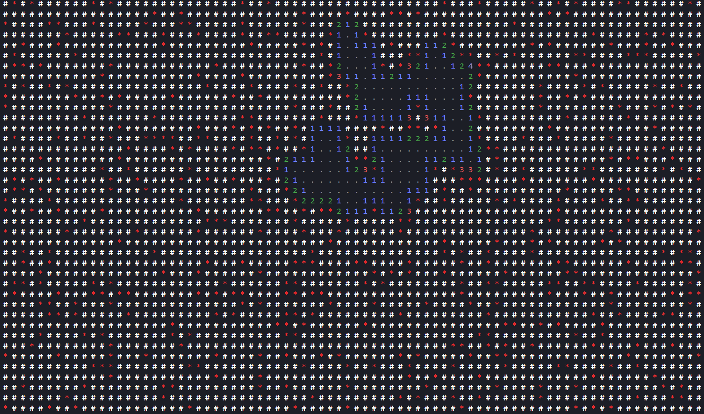

# mnswpr
mnswpr is a command-line version of minesweeper written in C#.

## running
In order to play, your system is required to have a .NET runtime installed. If that is so, you can either build and run the project manually, or run one of the start scripts:

### linux
``./run.sh``

### windows
``.\run.bat``

### controls
Move the cursor around using the arrow keys and perform actions on the selected tile by pressing the corresponding keys: F to flag, C to chord and R to reveal. The cursor may be slightly hard to see in some terminals.

## about
This project was intended as a learning project to get my hands dirty and learn C# fundamentals. The project has previously had a working version, albeit a much less polished and elegant one, thus I decided to refactor everything. I owe my now reignited passion for programming to this little game! If you've read this far, thank you! Much love!!
